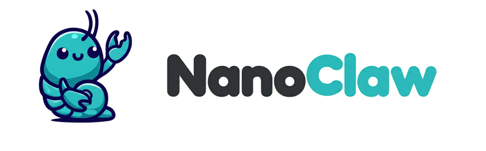

<p align="center">
  
</p>

<p align="center">
  NanoClaw + Virtual Character mode — a persona layer for giving a NanoClaw group its own identity, mood, schedule, and presence.
</p>

---

## What is NanoClaw?

[NanoClaw](https://github.com/qwibitai/nanoclaw) is an open-source AI assistant that runs Claude agents in isolated Linux containers instead of a shared process with application-level permission checks. It's built to stay small enough that one person can actually read and understand the whole codebase — one Node.js process, a handful of files, no microservices, no configuration sprawl. Customization happens by having Claude Code modify your fork directly, and by adding [skills](https://code.claude.com/docs/en/skills) — self-contained instructions or code that transform your fork to add a capability (a channel, an integration, a workflow) without bloating the base system for everyone else.

This repo is a fork of [qwibitai/nanoclaw](https://github.com/qwibitai/nanoclaw), released under the same MIT license, with full credit to the original author and contributors (see [CONTRIBUTORS.md](CONTRIBUTORS.md) and [LICENSE](LICENSE)). **This is a clean-history snapshot prepared for public release** — it is not a live deployment, and contains no real user data, credentials, or account-specific configuration.

## What this repo adds: Virtual Character mode

The base NanoClaw assistant is a helpful, neutral tool. This fork adds an optional layer for groups that want something closer to an actual *character* — a persona with its own identity, moods, a sense of a day passing, a writing style, and a face — while leaving every default-configured group completely unaffected.

- **Per-group identity config** — a group's name, trigger word, and style are data in `group.json`, not code. Every group can be a different character with zero shared state.
- **Mood-distribution engine** — moods aren't a single enum value; a character is a *blend* ("50% focused, 30% tired, 20% playful") that colors its writing style, with a fully custom palette per character and a configurable fallback mood/energy instead of a hardcoded default.
- **Schedule-driven presence simulation** — a persona can have a day: named activity blocks, an interruptible/non-interruptible distinction for "solo" activities, and (optionally) a lightweight social calendar so it isn't always sitting by the phone.
- **Style-marker configuration** — signature verbal tics (an emoji, a phrase, a sign-off) that make a persona's messages recognizable, calibrated against the real user's own writing style without ever fully mimicking it.
- **Avatar pipeline** — drop an image in the group folder and it's served to every client that renders the persona's face, with a graceful fallback when there isn't one.
- **An interview-driven character workflow** — the [`/virtual-character`](.claude/skills/virtual-character/SKILL.md) skill walks through designing a character *with* it, not for it: an eight-part interview (name, lore, visual design, world, schedule, style, mood palette, continuity), a machine-readable `decisions.json` derived from the character's own answers, and templates for wiring the result into every extension point above.

None of this requires new infrastructure — it's config, prompts, and a handful of small, focused engines that read that config. A default NanoClaw install with no `group.json` overrides behaves exactly like upstream.

## Architecture

```
                     ┌─────────────────────────┐
   inbound message → │   Context Builder        │
                     │  (per-message assembly)  │
                     └───────────┬──────────────┘
                                 │ injects
             ┌───────────────────┼───────────────────┐
             ▼                   ▼                   ▼
     ┌───────────────┐   ┌───────────────┐   ┌────────────────┐
     │  Mood Engine   │   │ Presence      │   │ Style Tracker  │
     │  distribution  │   │ Engine        │   │ (calibration,  │
     │  + fallback +  │   │ schedule /    │   │  signature     │
     │  mood_behaviors│   │ solo-activity │   │  markers)      │
     └───────┬────────┘   │ interrupts    │   └────────────────┘
             │            └───────┬───────┘
             │                    │
             ▼                    ▼
     ┌─────────────────────────────────────┐
     │      Scheduled-Task World Sim        │
     │  nightly mood plan · diary · weekly  │
     │  reflection · social weave           │
     └───────────────────┬───────────────────┘
                          ▼
              ┌─────────────────────────┐
              │  Claude Agent SDK        │
              │  (.system-prompt +       │
              │   CLAUDE.md + context)   │
              └─────────────────────────┘
```

- **Mood engine** (`src/channels/web/mood.ts`, `mood-style.ts`) — resolves the active mood distribution (scheduled, drifted, or manually tagged), regenerates a cached one-sentence writing-style summary via a cheap model call only when the blend changes meaningfully, and falls back to `group.json`'s `mood.fallback` rather than a hardcoded default.
- **Presence engine** (`src/presence/`) — computes online/away/deferred-reply state from the schedule and (optionally) the social calendar, so a character can be believably "doing something else" without the human maintaining that by hand every day.
- **Scheduled-task world simulation** (`src/task-scheduler.ts` + tasks seeded in `src/channels/web/web-channel.ts`) — the nightly mood-schedule plan, weekly reflection, and (feature-gated) diary/social-weave tasks that let a persona keep its own state current without per-message intervention.
- **Context builder injection pipeline** (`src/channels/web/context-builder.ts`) — assembles the per-message prompt prefix: mood/style hints, schedule state, topic-triggered memory files, social/dates hints — all gated behind per-group feature flags so an unconfigured group sees none of it.

## Design principles

**Defaults preserve upstream behavior.** Every virtual-character feature is opt-in per group via `features.*` flags in `group.json`, with fallbacks (`mood.fallback`, default signature markers) that keep the system functional and generic when a group doesn't configure them. A fresh install behaves exactly like base NanoClaw.

**Personas are data, not code.** A character's name, lore, mood palette, schedule, and style live in `group.json`, `.system-prompt`, and `mood_behaviors.json` inside that group's own folder — never in source. Two personas never share state, and adding a new one never means touching the codebase.

**Character consent workflow.** The [virtual-character skill](.claude/skills/virtual-character/SKILL.md) treats the character as a collaborator in its own design, not a config the operator fills in alone: an interview produces the character's own answers, and the drafted identity charter and mood palette are read back to the character for approval before being treated as final. A persona designed by having something invent answers on its behalf, with no read-back, isn't really a character — it's a mask with no one behind it.

## Getting started

Follow upstream NanoClaw's [Quick Start](https://github.com/qwibitai/nanoclaw#quick-start) and `/setup` skill to get a running instance, then run `/virtual-character` to design a persona for a group. See [.env.example](.env.example) for the environment surface and [CONTRIBUTING.md](CONTRIBUTING.md) for the skill taxonomy this project follows.

## Credit

Built on [qwibitai/nanoclaw](https://github.com/qwibitai/nanoclaw) by Gavriel and contributors, MIT licensed. See [CONTRIBUTORS.md](CONTRIBUTORS.md) and [LICENSE](LICENSE). This fork's additions (Virtual Character mode and the accompanying skill) are released under the same MIT license.
